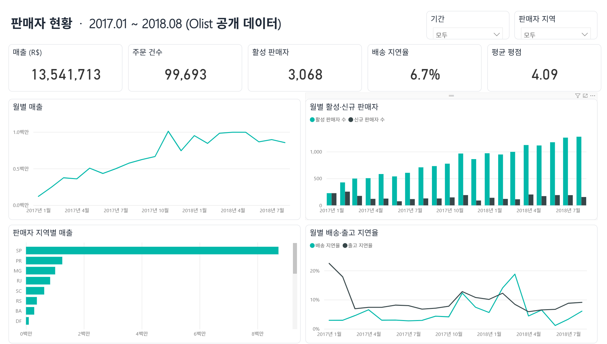
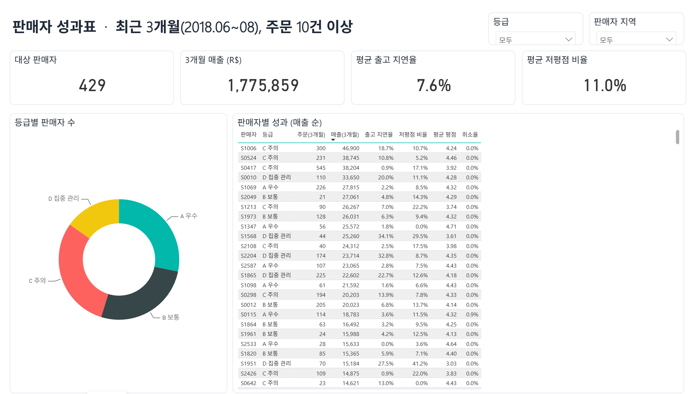
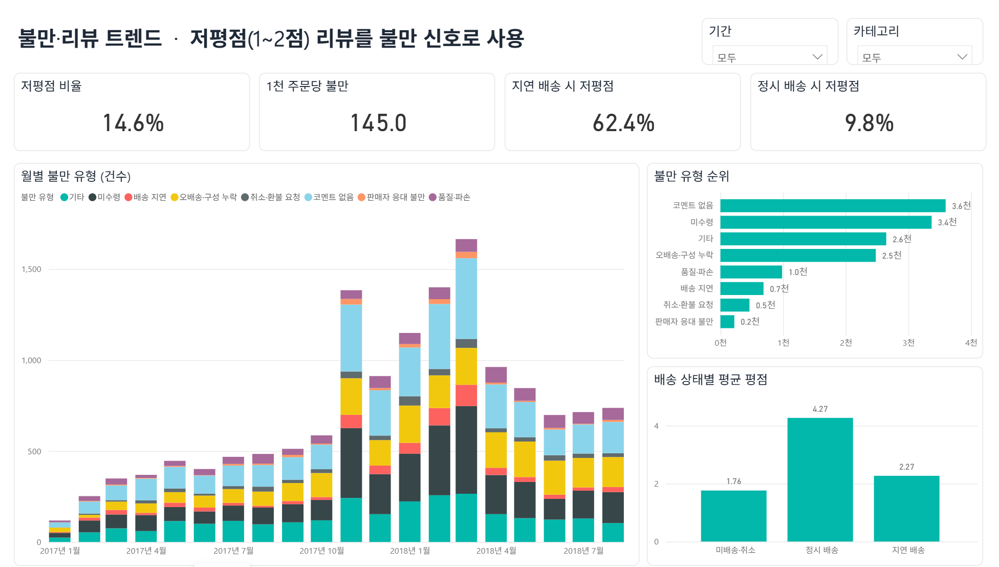

# 판매자 성과·불만 모니터링 대시보드 (Power BI)

이커머스 마켓플레이스의 **판매자 운영 지표**를 한 화면에서 관리하기 위한 Power BI 대시보드입니다.
공개 데이터(Olist 브라질 이커머스, 2017.01~2018.08, 주문×판매자 99,693건, 판매자 3,068곳)로 만들었습니다.

## 무엇을 보여주나
| 페이지 | 질문 | 주요 지표 |
|---|---|---|
| 1 판매자 현황 | 판매 규모와 판매자 풀은 어떻게 변하나 | 매출, 주문 건수, 활성·신규 판매자, 배송·출고 지연율 |
| 2 판매자 성과 관리 | 누구를 먼저 관리해야 하나 | 최근 3개월 판매자 성과표, 등급(A 우수 ~ D 집중 관리) |
| 3 불만·리뷰 트렌드 | 고객 불만은 무엇이고 어디서 생기나 | 저평점 비율, 1천 주문당 불만, 불만 유형(미수령·오배송 등) |

## 화면
| 판매자 현황 | 판매자 성과 관리 | 불만·리뷰 트렌드 |
|---|---|---|
|  |  |  |

## 확인된 인사이트 (데이터 기준)
- 배송이 약속일보다 늦으면 저평점(1~2점) 비율이 **9.8% → 62.4%**로 오른다 → 판매자 출고 관리가 고객 만족의 가장 큰 레버
- 저평점 리뷰 중 코멘트가 있는 건의 약 4분의 3이 규칙으로 분류되며, **미수령·오배송/구성 누락**이 가장 많다
- 주문 10건 이상 판매자 429곳 중 65곳이 'D 집중 관리'(출고 지연율 20% 이상 또는 저평점 25% 이상)

## 구조
```
data/raw/        Olist 원본 CSV 8개 (위치 데이터 1개는 미사용이라 제외)
sql/             01_staging.sql(정제) · 02_mart.sql(스타 스키마·불만 분류·성과표)
pipeline/        build_mart.py(마트 생성 + 품질 검사) · gen_pbip.py(Power BI 프로젝트 생성)
data/mart/       Power BI가 읽는 CSV 4개
powerbi/         SellerDashboard.pbip (Power BI Desktop에서 열기)
docs/            data_quality.md(자동 생성) · 지표정의.md
```

## 실행
```bash
pip install duckdb
python pipeline/build_mart.py    # 원본 → 마트 CSV + docs/data_quality.md
python pipeline/gen_pbip.py      # (구조를 바꿨을 때만) Power BI 프로젝트 다시 생성
```
그다음 `powerbi/SellerDashboard.pbip`를 Power BI Desktop에서 열고 **홈 → 새로 고침**.
데이터 폴더 경로는 Power Query 매개변수 `DataFolder`에서 바꿀 수 있습니다.

## 데이터 모델
- 팩트: `fact_order_seller` (주문×판매자 1행) — 매출, 리드타임, 출고·배송 지연 여부, 리뷰 점수, 불만 유형
- 차원: `dim_seller`(판매자 코드·지역·첫 판매월), `dim_date`(날짜 테이블)
- 요약: `seller_scorecard` (최근 3개월 판매자별 성과·등급)
- 관계: 팩트 → 판매자·날짜 (다대일, 단방향), 성과표 → 판매자

## 한계
- 실제 상담·문의 기록이 없어 **저평점 리뷰를 불만 신호로 대신 사용**했습니다
- 불만 유형은 포르투갈어 키워드 규칙이며, 표본 60건 검수에서 51건(약 85%)이 맞았습니다(검수는 AI 도구 보조)
- 리뷰는 주문 단위라, 여러 판매자가 섞인 주문(2.6%)은 같은 점수가 각 판매자에 귀속됩니다
- 데이터가 2018년에서 끝나므로 '실시간' 대신 CSV 새로 고침 방식으로 갱신을 구현했습니다

## 도구
DuckDB SQL · Python · Power BI Desktop(Power Query, DAX, PBIP/TMDL) · AI 코딩 도구 보조(Claude Code)

## 데이터 출처와 라이선스
- 데이터: [Brazilian E-Commerce Public Dataset by Olist](https://www.kaggle.com/datasets/olistbr/brazilian-ecommerce) (Kaggle)
- 라이선스: **CC BY-NC-SA 4.0** — `data/raw/`(원본)와 `data/mart/`(가공 결과)는 같은 라이선스를 따르며 비상업적 용도로만 사용할 수 있습니다
- 판매자·고객 ID는 원본에서 이미 익명화된 해시값이며, 대시보드에는 짧은 코드(S0001 등)로 표시합니다
- `olist_geolocation_dataset.csv`(61MB)는 이 프로젝트에서 쓰지 않아 저장소에서 제외했습니다
